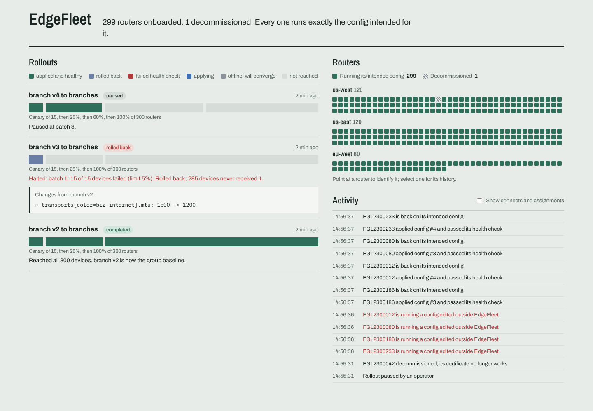

# EdgeFleet

A control plane for a fleet of edge routers: zero-touch onboarding with device
certificates, versioned config templates, staged rollouts that stop a bad config at
the canary and roll it back, and continuous reconciliation that catches drift.

Java 21 and Spring Boot, gRPC over mutual TLS, PostgreSQL, a React dashboard, and a
device simulator that runs hundreds of routers on a laptop.



## What happens to a router

1. **Provisioning.** An operator imports a provisioning file: serial numbers, system
   IPs, sites and per-device template variables. Each device gets a one-time bootstrap
   token. Only its SHA-256 is stored.
2. **Zero-touch claim.** The router generates its own EC key pair, then calls
   `Bootstrap.Claim` over TLS with its serial, token and a CSR. The controller's CA
   checks the CSR (signature, CN equals serial, key strength) and issues a client-only
   identity certificate. The token is spent in the same transaction. The private key
   never leaves the device.
3. **Day-0 config.** If the router's group has a baseline template, its rendered config
   is queued in that transaction too, so it arrives as soon as the session opens.
4. **Control session.** The router opens one long-lived gRPC stream over mutual TLS.
   Its identity comes from its certificate, never from message fields, and the
   certificate must be its current one, so a decommissioned router is refused.
5. **Config pushes.** Every push carries a strictly increasing per-device version. The
   router applies it with confirm semantics: apply, run the health check, and revert on
   its own if the check fails. A bad config cannot strand a router the controller can
   no longer reach.
6. **Reconciliation.** On every hello and heartbeat the controller compares what the
   router runs (version and config hash) with what it intends, and fixes any gap.

## Design decisions

**Versions never go backwards.** A rollback is a new version whose content is an older
config. The device discards any push not newer than what it runs, and re-acknowledges
a duplicate of its current version without reapplying. Late, duplicated or reordered
deliveries are harmless, which makes at-least-once delivery safe.

**The database is the source of truth; the session is transport.** Pushes are rows in
`commands`. They are sent right after the transaction that queued them commits, with a
sweep as backstop. Rows are claimed with `FOR UPDATE SKIP LOCKED`, so two controller
instances never send the same push.

**Level-triggered reconciliation.** The controller does not trust that a push it sent
arrived. Each heartbeat re-derives the action from intended versus reported state: push
again, flag drift, or do nothing. A config the device already rejected is not retried
in a loop; that decision belongs to the rollout engine or an operator.

**Staged rollouts with health gates.** A deployment shuffles the group, so the canary is
a random sample. It pushes one batch at a time (for example 5%, then 25%, then 100%) and
waits for every device to report healthy. If a batch's failure rate exceeds the limit,
or provably will before all results are in, the rollout halts and pushes the previous
config back to every device it touched. Before anything is pushed, a pre-flight renders
and validates the template for every target, and a single failure refuses the whole
deployment.

**Restart-safe.** Rollout state lives in Postgres, and each engine tick runs in one
transaction under `pg_try_advisory_xact_lock`. Only one controller instance drives
rollouts, and a restarted controller continues from the exact batch where the last one
stopped (measured below).

**Offline devices don't block a rollout.** A router without a session when its batch
starts is marked deferred. Its intended config is still updated, so it converges when
it reconnects, but it neither counts as a failure nor holds the rollout up.

**One hash, computed the same way on both sides.** The `config-model` module (canonical
JSON, SHA-256, template rendering, validation, diff) is shared by the controller and
the device. A router reports only a 64-character hash, and the controller can tell
whether it runs exactly the intended bytes.

## Measured

`scripts/e2e.sh` runs the whole story against 500 simulated routers and writes
`results.json`. This run was on a 2-vCPU Linux VM, with the controller, its Postgres and
all 500 routers sharing those two cores
([raw results](docs/e2e-results.json)):

| Scenario | Result |
|---|---|
| Zero-touch onboarding to day-0 config | all 500 claimed and in sync in 29.7 s; claim p50 2.2 s, p99 7.1 s (64 in flight) |
| Staged rollout, 5% then 25% then 100% | 500 routers on the new version in 5.1 s, no failures |
| Bad config (internet MTU 1200: valid, but it fragments IPsec) | canary of 25 failed its health check; halted and rolled back in 2.5 s; 475 routers never received it |
| 20 routers hand-edited on the CLI | 20 of 20 detected within 20 ms of the next heartbeat; back on the intended config in 0.21 s median, 0.33 s worst |
| Controller SIGKILLed mid-rollout, down 20 s | serving again 33 s after the kill; the rollout resumed at the same batch and completed; all 500 reconnected and in sync 64 s after the kill |
| Reconnect storm during that outage | 3,112 reconnect attempts by 500 routers (about 6 each) with jittered backoff |

Onboarding time varies between runs on a shared 2-core VM; an earlier run of the same
script took 20.2 s.

### Bugs these runs found

- **No connection pool in dev mode.** With embedded Postgres the controller first used
  the database's own unpooled data source, so every query opened a connection. At 500
  concurrent devices Postgres answered `too many clients`, and one claim in 500 failed.
  It now uses Hikari like production, which roughly halved onboarding time and claim
  latency.
- **Orphaned Postgres after SIGKILL.** Postgres runs as its own process, so a
  SIGKILLed controller left it alive holding the data directory, and the next
  controller could not start. The controller now detects that orphan from the lock file
  and stops it before starting.
- **Lockstep reconnects.** Without jitter, routers retried in lockstep: a 2-minute
  outage produced 15,183 reconnects. Jittered exponential backoff that only resets after
  30 stable seconds brought a comparable outage down to 3,112.
- **Opaque errors.** Unexpected failures in `Claim` now return `UNAVAILABLE`, which
  devices retry with backoff, instead of `UNKNOWN`.

## Run it

**Without Docker** (Java 21, Maven, Python 3; Postgres runs embedded):

```bash
mvn -q install -DskipTests
./scripts/e2e.sh 500          # the full measured scenario above; results in .e2e/results.json
```

Or step by step:

```bash
java -jar controller/target/controller-0.1.0.jar            # REST :8090, bootstrap :50051, sessions :50052
curl -X POST localhost:8090/api/templates -H 'Content-Type: application/json' --data @examples/branch-template.json
curl -X PUT localhost:8090/api/groups/branches/baseline -H 'Content-Type: application/json' -d '{"template":"branch","version":1}'
python3 tools/make_inventory.py --devices 200 > inventory.json
curl -X POST localhost:8090/api/inventory -H 'Content-Type: application/json' --data @inventory.json > tokens.json
curl localhost:8090/api/pki/ca.crt > ca.crt
java -jar device-sim/target/device-sim-0.1.0-exec.jar --ca ca.crt --tokens tokens.json
cd dashboard && npm install && npm run dev                   # http://localhost:5174
```

**With Docker:** `docker compose up --build` starts Postgres, the controller and the
dashboard (http://localhost:3001). Run the simulator from the host as above.

**Tests:** `mvn verify` runs unit tests (config model, CA) and integration tests that
start the real controller on embedded Postgres with both TLS listeners and drive real
simulated routers through claims, revocation, rollouts, a bad-config rollback,
pre-flight failure, drift and offline convergence.

## API

| Endpoint | |
|---|---|
| `POST /api/inventory` | Import a provisioning file; returns one-time bootstrap tokens |
| `GET /api/devices`, `GET /api/devices/{serial}` | Fleet and per-router detail with config history and events |
| `GET /api/devices/{serial}/config` | The intended config, canonical JSON |
| `POST /api/devices/{serial}/decommission` | Revoke a router; its live session is closed |
| `POST /api/templates`, `GET /api/templates/{name}/diff?from=&to=` | Immutable template versions and their structural diff |
| `GET /api/templates/{name}/{v}/preview?serial=` | Render for one router and show what would change |
| `PUT /api/groups/{group}/baseline` | Day-0 config for a group |
| `POST /api/deployments`, `GET /api/deployments/{id}` | Staged rollouts and per-batch status |
| `POST /api/deployments/{id}/pause\|resume\|rollback` | Operator control |
| `GET /api/events?afterId=` | Append-only event log (onboarding, pushes, results, drift, rollouts) |
| `GET /api/fleet/summary` | In sync, behind, drifted, offline |

## Layout

| Module | |
|---|---|
| `proto` | `Bootstrap` and `ControlSession` gRPC contracts |
| `config-model` | Canonical hashing, template rendering, validation, structural diff (shared) |
| `controller` | CA, onboarding, sessions, dispatcher, reconciliation, rollout engine, REST API |
| `device-sim` | `DeviceAgent` (one router) and a fleet simulator with reconnect and drift injection |
| `dashboard` | React + TypeScript view of rollouts, routers and activity |

## Limits

- The CA key sits in a file. Production would use an HSM or a secrets manager, and
  device certificates would be renewed before expiry.
- One controller instance holds a router's session. Several instances work for pushes
  (the dispatcher and the rollout lock are multi-instance safe), but the REST summary
  counts only local sessions.
- Bootstrap tokens stand in for the manufacturer-installed device certificates real
  zero-touch provisioning uses as proof of identity.
- Docker Compose has not been run yet; everything else above was.
